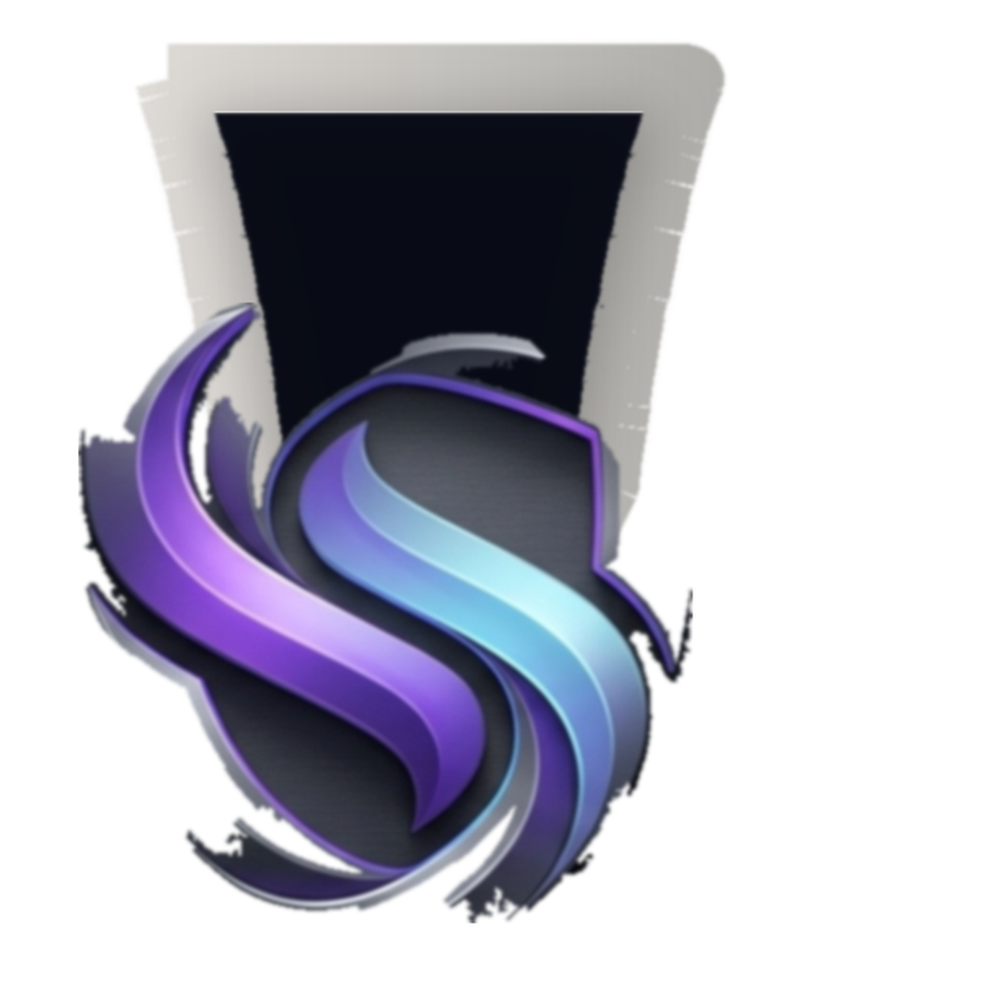

<div align="center">



# ShadRox

**Your project, code, AI, and preview — in one Windows workspace.**

[](https://www.shadrox.cyou/releases)
[](https://www.shadrox.cyou/download)
[](./LICENSE)

[Download for Windows](https://www.shadrox.cyou/download) · [All releases](https://www.shadrox.cyou/releases) · [Support](https://www.shadrox.cyou/faq#support)

</div>

ShadRox is a native Electron desktop app that puts a code editor, BYOK AI chat and agent, live project preview, Git tools, a bundled Node debugger, and an integrated terminal in one window. Open a local folder, edit files, ask your own AI provider for help, run the project, and commit — without leaving the workspace. Project files stay on your disk; only the prompt and context you choose are sent to the provider you configure. ShadRox is free, bring-your-own-key only, and has no billing.

> **Beta software (v0.1.4).** Agent output and model-generated edits can be incorrect. Review changes, keep backups or use Git, and do not approve commands you do not understand. See [BETA_TERMS.md](./BETA_TERMS.md).

## Features

- **Editor** — CodeMirror 6, split groups, pinned tabs, quick open, outline, Ctrl+K inline AI edit, ghost-text completions, Markdown source/preview toggle.
- **AI chat (BYOK)** — Gemini, Groq, or any OpenAI-compatible endpoint with your own key; Ask/Plan/Agent modes, `@` mentions, file/photo attachments, message queue.
- **Agent with guardrails** — risk-tiered command approval (safe commands auto-run, risky ones ask, dangerous ones always ask in red), background jobs, contract-aware TypeScript repairs, verified file writes.
- **Bundled Node debugger** — ships `@vscode/js-debug` with an automatic stdio-to-TCP DAP bridge for breakpoints, step-debugging, and local variable inspection with zero external setup.
- **Live preview** — static sites, Node web frameworks, and detected Python/Go/PHP/Java/.NET backends, with a bounded health check.
- **Terminal** — interactive shell rooted in the workspace; PowerShell and bash report cwd and exit codes.
- **Git & checkpoints** — diffs, staging, AI commit messages, branches, conflict resolution, GitHub push, and rewindable workspace checkpoints.
- **Multi-step runs & teams (beta)** — larger goals escalate from chat to a plan-edit-verify run or a coordinator-led agent team with explicit target-file checks.
- **Extensible** — MCP servers, project rules and skills, plugins and automations (beta).

## Quick start

1. **Download** the installer from [shadrox.cyou/download](https://www.shadrox.cyou/download) (`ShadRox-v0.1.4-Setup.exe`, Windows 10/11, 64-bit). The build is unsigned — if SmartScreen warns, verify the download source, then choose **More info → Run anyway**. Details in [INSTALL.md](./INSTALL.md) and [docs/troubleshooting.md](./docs/troubleshooting.md).
2. **Install and sign in** with Google (required; you must accept the Terms and Privacy Policy first).
3. **Add your own API key** in **Settings → Models & Keys** — Gemini, Groq, or a custom OpenAI-compatible endpoint. See [docs/byok.md](./docs/byok.md).
4. **Open a folder** and start editing, asking, running, and committing.

## Documentation

| Page | What it covers |
|---|---|
| [docs/features.md](./docs/features.md) | Editor, chat/agent, runs & teams, preview, terminal, Git/checkpoints, MCP, debugger, tech stack, building from source |
| [docs/byok.md](./docs/byok.md) | Providers, where keys are stored, what leaves your machine, accounts and billing |
| [docs/agent-tools.md](./docs/agent-tools.md) | Agent tool surface, command risk tiers, background jobs, loop limits, safety model |
| [docs/troubleshooting.md](./docs/troubleshooting.md) | SmartScreen, preview port conflicts, pnpm/bun projects, OneDrive locks, logs |
| [docs/faq.md](./docs/faq.md) | Plain answers to common questions |
| [INSTALL.md](./INSTALL.md) | Beta installation steps |
| [SECURITY.md](./SECURITY.md) | Reporting vulnerabilities |
| [PRIVACY.md](./PRIVACY.md) | Privacy summary |
| [BETA_TERMS.md](./BETA_TERMS.md) | Beta terms of use |
| [LICENSE](./LICENSE) | Proprietary copyright notice & license (All rights reserved) |

## Development

Requires Node.js 22.12+ and npm. A Supabase project with Google sign-in is needed to run from source (`cp .env.example .env`, then set `VITE_SUPABASE_URL` and `VITE_SUPABASE_ANON_KEY`).

```sh
npm install
npm test             # Node test suite (src/, electron/, api/)
npm run typecheck    # bundled TypeScript 5.9 service
npm run dev:desktop  # dev server + Electron app
```

Full command list, benchmark, and packaging notes: [docs/features.md](./docs/features.md#building-from-source).

## License & Intellectual Property

ShadRox is proprietary software ([All Rights Reserved](./LICENSE)). Copyright (c) 2026 ShadRox — founded and owned by **Sourav Maurya**. Unauthorized copying, redistribution, modification, or commercial exploitation of ShadRox without written permission from the founder is prohibited. No warranty; third-party open-source dependencies retain their own licenses.

Founded & built by [Sourav Maurya](https://www.shadrox.cyou/about). [Website](https://www.shadrox.cyou) · [LinkedIn](https://www.linkedin.com/in/sourav-maurya-45b272377)