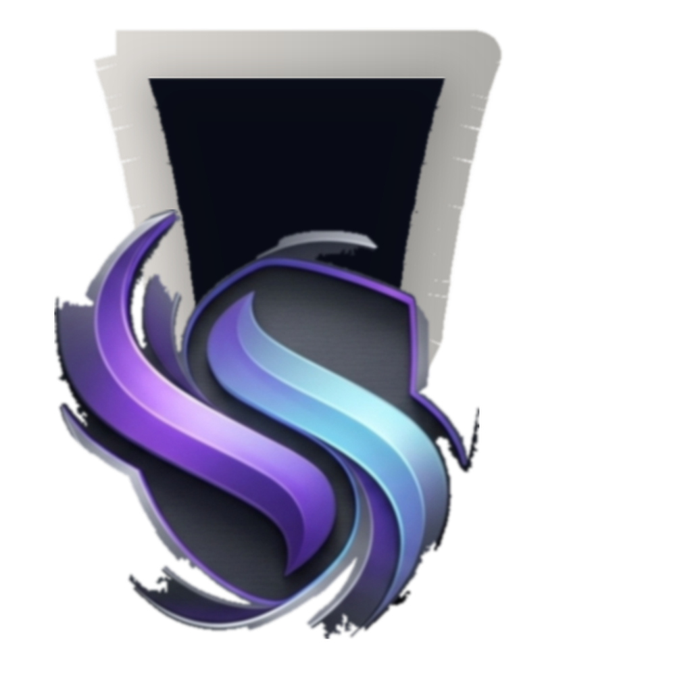

<div align="center">



# ShadRox

### Your project, code, AI, and preview — in one workspace.

A native desktop workspace for working on local projects with an editor, Markdown preview, BYOK AI chat, project preview, Git tools, and an integrated terminal.

[](https://github.com/iamsouravmourya-jpg/ShadRox/releases)
[](https://github.com/iamsouravmourya-jpg/ShadRox/releases)
[](./LICENSE)
[](https://www.electronjs.org/)
[](https://react.dev/)
[](https://www.typescriptlang.org/)

[Download for Windows](https://github.com/iamsouravmourya-jpg/ShadRox/releases/latest/download/ShadRox-v0.0.6-Setup.exe) · [All Releases](https://github.com/iamsouravmourya-jpg/ShadRox/releases) · [Report an Issue](https://github.com/iamsouravmourya-jpg/ShadRox/issues)

</div>

---

> **ShadRox is beta software (v0.0.6).** It is not a mature replacement for a general-purpose IDE. Agent output and model-generated edits can be incorrect — inspect proposed changes and keep backups or use Git for important work.

The download button points at the **last published** GitHub release. This source tree is still version `0.0.6` and includes the behavior below. A newer local installer is not on GitHub until it is published.

**In this source tree**
- **Assistant shell access.** The agent can run a command in the opened folder and read its real exit code and output.
- **Command approval.** Only these exact forms may run without a dialog: `npm test`, `pytest`, `python -m pytest`, `tsc --noEmit`, `npx tsc --noEmit`, `git diff`, `git status`. The match is on the whole command line, so an extra argument — `tsc --outFile build.js`, `git diff --output patch.txt`, `pytest tests/unit` — is not on the list and needs approval, and any shell metacharacter or path separator (`; & | > < $ \` ( ) / \ quote`) is refused before the match. Every other command needs a native approval dialog. The workspace is checked again after approval and before the command runs.
- **Verified writes.** After applying edits, ShadRox re-reads the files and only reports a save when the bytes on disk actually changed.
- **Terminal state.** PowerShell and bash emit OSC 133 / 633 markers for cwd, command text, and exit code. The panel shows cwd and the last exit code, and notices a running command that has gone silent. Command Prompt and plain `/bin/sh` are not wrapped. The agent can read that summary with `terminal_state`. It cannot type into the interactive shell.
- **Failure receipts.** A failed `run_command` is shown on the assistant message with that turn's undo checkpoint id. The model receives the error and a repair brief. ShadRox does not apply a repair patch by itself.
- **Preview.** Stale preview servers and Next.js dev locks are cleaned up the next time that project starts. After a preview is ready, a bounded check reports `ok`, `warn`, `fatal`, or `observed`. `observed` means the check could not prove the page.
- **Debugger.** Add a `shadrox.debug.json` at the workspace root with one or more `node` launch configurations, then start it from the Debug panel: breakpoints go in the editor gutter, the paused frame and its locals open beside the code, and hovering an identifier while paused evaluates it in that frame. Programs and working directories outside the workspace are refused.
- **Proof and spend.** Assistant commands append a local signed ledger line with the redacted command, hashes of the command and its output, and the exit code — never the output text. Settings tracks provider-reported token use, including cache hits when the provider sends them.
- **Workspace consent.** Reopening a folder or file requires a path the main process already accepted. An unknown path asks again before it is mounted.
- **Credential scrubbing.** API error text is redacted for GitHub and AWS-shaped tokens. Terminal environments drop credential-shaped variables.
- **Context budgets.** Prompt fitting uses per-model window and output limits. Stable prompt prefixes are shaped for providers that can cache them.
- **Replies and logo.** Assistant answers render as cards. The shield-and-ribbon mark is the app icon. Landing call-to-action accents use silver, violet, and cyan.

## What is ShadRox?

ShadRox brings your project explorer, code editor, Markdown preview, AI chat, local web preview, Git tools, and terminal into one Electron desktop app. Open a folder, browse and edit files, review AI-proposed changes, and run supported projects without leaving the workspace.

Your project files stay **on your computer**; ShadRox does not sync project folders to a cloud workspace. When you ask AI for help, the prompt and included project context are sent to the provider you selected. Provider keys are stored in the desktop app's OS-backed encrypted store and are not sent to ShadRox.

## Features

| | Feature | What it does |
|---|---|---|
| 🛡️ | **Command approval** | A short verify allowlist can run silently. Any other shell command waits for a native dialog. `delete_file` also requires `confirm: true` and a follow-up read that proves the path is gone. |
| 📟 | **Terminal state** | PowerShell and bash report cwd, the command line, and the exit code. The panel shows them, and `terminal_state` lets the agent read the same summary, including how long a command has been silent. |
| 🩹 | **Failure receipts** | A failed assistant command becomes a receipt on the chat message, with the turn's undo checkpoint id. The model sees the error. A patch is still a normal reviewed edit, not an automatic rewrite. |
| 📊 | **Proof and spend** | Command ledger lines store the redacted command, hashes and exit code — not output text — in a signed Ed25519 chain. Spend tracking uses the token counts the provider reports, including cache hits when that field exists. |
| 📁 | **Project Explorer** | Open a local folder or selected files, browse the workspace tree, and create, rename, or delete files and folders. Files are loaded as you open them. |
| ✏️ | **Editor & Markdown preview** | CodeMirror 6 editing, split editor groups, pinned/reorderable tabs, quick open, outline, inline completions, and a one-click source/preview toggle for Markdown files. |
| 🔍 | **Code navigation** | TypeScript diagnostics, go-to-definition, find references, rename, quick fixes, semantic highlighting, and workspace symbol search where supported. |
| 💬 | **AI chat and queue** | Use Gemini, Groq, or a custom OpenAI-compatible endpoint. Replies render as cards with headings, tables, quotes, and copyable code blocks. Queue follow-up messages while a turn is running; inspect proposed file changes and review supported diffs before applying. Dictate prompts with voice input. |
| ⌘ | **Command palette & quick edit** | Fuzzy-find files, workspace symbols, and commands from one palette; select code and press Ctrl+K for an inline AI edit; accept ghost-text completions powered by server-side FIM. |
| 🤖 | **Bounded agent loop** | Multi-round tool use with native provider calls where supported and a text-protocol fallback. Built-in tools list directories, read files, search names and text, inspect diagnostics and Git state, outline files, delete one path, read terminal state, answer a running prompt with approval, read the paused debugger, and run one shell command with its real exit code. Every request also carries a compact repo map. Turns have tool and iteration limits. |
| 🚀 | **Multi-step runs and teams** | Plan larger work as tasks, run verification/repair stages, or coordinate specialist roles. Features an autonomous DAG execution engine and role-confined agent teams. |
| 🔌 | **MCP servers** | Connect user-configured Model Context Protocol servers. External tool calls require approval. |
| 👁️ | **Local preview & assertions** | Preview Markdown, static sites, detected Node web projects, and Python/Go/PHP/Java/.NET backends. Includes DOM route, element, and console error assertions. |
| 🧭 | **Behavior-to-Code Studio** | Record preview clicks and runtime errors, map interactions to source paths, and generate an editable acceptance contract with baseline and post-patch verification states. |
| 🧠 | **Living Intent Graph** | Index workspace symbols and dependencies, persist approved rationale locally, flag decisions stale after SHA-256 changes, and inject budgeted intent context into AI tasks. |
| 📈 | **Outcome-Calibrated Auto** | Record route outcomes, pass rates, repair iterations, token use, and latency locally; Auto ranks models using verified historical results instead of token price alone. |
| 🧩 | **Task Inspector** | One dock for capsules, Intent Graph, Behavior Studio, and Calibrated Auto. Capsule and intent data support offline JSON export/import. |
| 🔀 | **Source control** | Inspect staged and unstaged Git changes, preview file diffs, stage or unstage, commit with AI-generated messages, switch local branches, and detect and resolve merge conflicts. |
| 🔎 | **Workspace search & replace** | Search files on disk and in buffers, review matching results, and replace selected or matching text. |
| ⏮️ | **Checkpoints** | Review assistant checkpoints and restore earlier workspace content. |
| 📝 | **Rules & skills** | Load project conventions from `SHADROX.md`, `AGENTS.md`, `QODER.md`, `.cursorrules`, and `.shadrox/rules/*.md`; reusable skills live under `.shadrox/skills/`. |
| 🔗 | **GitHub integration** | Validate tokens and push code from the app; a repository-creation endpoint ships with the API layer. |
| 🔧 | **Plugins & automations** | Use declarative workspace plugins and scheduled or webhook-triggered automations. |
| ⏪ | **Machine Delta core** | Main-process snapshot, inspection, and explicit restore primitives for bounded workspace, local Git, and ShadRox-owned preview changes. |
| 🐛 | **Debugger (DAP)** | Launches a Node program declared in the workspace's `shadrox.debug.json` through the Debug Adapter Protocol: breakpoints in the editor gutter, call stack, scopes and variables, hover values while paused, and pause/continue/step. The adapter runs as a bounded argv process inside the workspace, never through a shell. Heap profiling is not included. |
| 🔄 | **Auto-updates** | The app checks for releases and installs downloaded updates when you restart or quit. |

### Task Inspector systems

The Task Inspector groups the local-first engineering records that accompany an AI task:

- **Behavior Studio** listens to preview bridge events such as source-mapped clicks and runtime errors. It keeps a bounded interaction history and turns it into an acceptance contract containing the target source location, observed failure, expected behavior, and reproduction steps.
- **Living Intent Graph** scans loaded source files for symbols and dependency edges. User-approved decisions are stored in browser local storage, re-hashed against current files, and marked `stale` when their governing content changes.
- **Outcome-Calibrated Auto** keeps a bounded local ledger of route, model, verification, repair, token, and latency outcomes. Model ordering is adjusted only when verified history exists; new models retain a neutral fallback order.

These records remain local to the workspace/browser profile. Use the Inspector's export controls to create portable JSON backups; imports are validated before they are stored.

## Architecture

```
┌─────────────────────────────────────────────────────────────────┐
│                        Electron Main Process                     │
│  main.cjs · preload.cjs · workspace.cjs · desktop-security.cjs   │
│  ┌──────────┐  ┌────────────┐  ┌──────────┐  ┌───────────────┐   │
│  │ TS Service│  │ Preview RT │  │ Terminal │  │ MCP Client    │   │
│  │ (LSP)     │  │ (node-pty) │  │ (xterm)  │  │ (approval-gated)│  │
│  └──────────┘  └────────────┘  └──────────┘  └───────────────┘   │
│  ┌──────────┐  ┌────────────┐  ┌──────────────────────────────┐  │
│  │ Updater   │  │ Git Ops    │  │ Automation Webhook           │  │
│  │(auto-update)│ │(create/push)│  │ (scheduler + HTTP triggers)  │  │
│  │ Workspace consent · command approval · Machine Delta core       │
│  └──────────┘  └────────────┘  └──────────────────────────────┘  │
└─────────────────────────────────────────────────────────────────┘
              ▲ IPC (context-isolated, preload bridge) ▼
┌─────────────────────────────────────────────────────────────────┐
│                     React 19 Renderer (Vite)                     │
│  ┌───────────┐ ┌──────────┐ ┌─────────┐ ┌────────┐ ┌─────────┐  │
│  │ File Tree  │ │ CodeEdit │ │ ChatPanel│ │ Preview│ │ Terminal│  │
│  │ Outline    │ │ (CM6)    │ │ Agent    │ │ Pane   │ │ Panel   │  │
│  │ QuickOpen  │ │ FIM      │ │ Timeline │ │ Click→ │ │ xterm   │  │
│  │ References │ │ Diag.    │ │ Settings │ │ source │ │         │  │
│  └───────────┘ └──────────┘ └─────────┘ └────────┘ └─────────┘  │
└─────────────────────────────────────────────────────────────────┘
              ▲ Express local server / Vite dev renderers dev server (server.ts) ▼
┌─────────────────────────────────────────────────────────────────┐
│                            API Layer                              │
│  /ai/chat · /ai/commit-message · /ai/fim · /byok/validate        │
│  /github/create-repo · /github/push · /prompt/refine             │
│  Gemini · Groq · OpenAI-compatible · BYOK · Budget/SpendGuard      │
└─────────────────────────────────────────────────────────────────┘
```

## How a request travels

```
 ┌──────────────┐      prompt + context      ┌──────────────────┐
 │  Your computer │  ───────────────────────▶  │  AI Provider      │
 │                 │                            │  (Gemini / Groq /  │
 │  • Local files  │  ◀───────────────────────  │   compatible)     │
 │  • BYOK key     │      response (stream)      └──────────────────┘
 │    (encrypted)  │
 │  • Project rules│   Supabase (auth only):
 │  • Skills       │   email, name, avatar,
 │  • Repo map     │   app version, platform
 └──────────────┘
```

Project files are edited locally on your disk. Only the prompt and the context you include go to the provider. Your provider key stays encrypted on your device.

## AI Agent: What It Does and Does Not Do

The agent is more than a one-shot text patch parser. It can request bounded rounds of workspace tools, receive their results, and continue reasoning.

**Built-in workspace tools:**
- Directory listing
- File reads
- Filename and text search
- Diagnostics
- Git state
- File outlines
- Delete one file or an empty folder (`delete_file`, requires `confirm: true`, then a disk check)
- Read the interactive terminal (`terminal_state`: cwd, running command, last exit code, silent seconds)
- Answer a running prompt (`terminal_answer`: one short line, shown in an approval dialog first)
- Read the paused debugger (`debugger_state`: top frame, scopes, bounded locals; read-only)
- One shell command per call (`run_command`)

`run_command` runs in the opened folder and returns the real exit code, stdout, and stderr. A model field is not permission. The verify allowlist above can run without a dialog; every other command opens a native approval dialog, and the workspace is checked again before execution. A non-zero exit becomes a failure receipt on that chat message. The command and its result are also echoed into the terminal panel. `terminal_state` only reads. `terminal_answer` types one printable line, and only into a terminal that is already running a command — never into an idle prompt — after the user approves the exact bytes; a cancel types nothing. Passwords, tokens and secrets are refused.

The model can also update its task plan and finish a turn explicitly. A turn is limited to **five tool rounds** by default, with up to six calls in a round.

**File changes** are proposed through ShadRox's patch format and sent through a patch/review/apply pipeline — they are never arbitrary model-issued filesystem writes. Changes that are unsafe to apply automatically (edits to files the turn did not read, destructive rewrites) are held for review rather than silently written. After applying, the app re-reads each file and reports a save only if the content on disk matches the proposed result.

> Providers with native function calling use it for tool requests; ShadRox normalizes those calls into its bounded tool contract. A ShadRox-formatted text protocol is the fallback for providers that do not support native tools. The loop is an early implementation and can make mistakes.

### Autonomous Engine

Multi-step requests can escalate from chat to a bounded autonomous run:

```
Goal → Plan (task DAG) → Milestone turn (guarded patches) → Verify
     ↑                                                        │
     └──── Repair brief (≤ maxAttempts) ◀──── failed ─────────┘
                  rollback to checkpoint on an unrecoverable failure
```

The engine plans work as a **task DAG** of milestones, applies changes through the same guarded patch pipeline, and **verifies** each milestone with diagnostics plus an optional approval-gated command. A failed milestone gets a repair brief and up to a configurable number of attempts; a run that still fails and has written files rolls the workspace back to its checkpoint.

### Agent Teams

For goals that span multiple concerns, a **Coordinator** splits the work and assigns each task to a specialist:

| Role | Owns | Does not touch |
|---|---|---|
| **Coordinator** | Planning and assignment | Never edits files |
| **Frontend** | Components, styling, client state, rendering | Server code, data access, tests |
| **Backend** | APIs, data access, services, build config | UI code, tests |
| **Tests** | Test files and fixtures | Product code (won't weaken tests to pass) |
| **Reviewer** | Reads results, reports problems | Changes nothing |

Teams share the same bounded tool loop and guarded patch path. Each agent's brief includes file ownership boundaries so they stay out of each other's way.

## AI Providers & Project Context

**Supported providers:**
- Google Gemini
- Groq
- Custom OpenAI-compatible endpoints (including Ollama, LM Studio, and compatible gateways)

The beta runs on **Bring Your Own Key (BYOK)**. Add a provider key in Settings; model availability and charges depend on that provider. While your own key carries the request, nothing is metered and nothing is capped — ShadRox bills no credits for it.

Two packs are the paid options, both GST-inclusive and both spent on the optional ShadRox shared key (Nova Micro reads context, Qwen3 Coder Flash writes patches, DeepSeek V4.1 Flash takes hard refactors):

- **Starter — ₹699 / month, 800 credits.** Small-to-medium edits and chat; worst-case upstream cost ₹280, so the month still leaves ~₹296 after GST and payment fees.
- **Heavy — ₹1,299 / month, 1,600 credits.** All-day agent runs plus continuous repo indexing; worst-case upstream cost ₹560, leaving ~₹510.

One credit is capped at ₹0.35 of upstream spend. No checkout is wired in this beta: selecting a pack unlocks it on that device and no payment is taken.

**Project context** is assembled locally for each request and can include:
- Selected files
- Search results
- A compact repository map
- Project rules
- Recent conversation (compacted without another model call when long)

> Only the prompt and context selected for a request are sent to its configured AI provider. Do not send private code to a provider unless its data-handling terms are acceptable to you.

**Project convention files:**

| File | Scope |
|---|---|
| `SHADROX.md` | Root project rules |
| `AGENTS.md` | Root or nested per-directory rules |
| `QODER.md` | Root project rules |
| `.cursorrules` | Root project rules |
| `.shadrox/rules/*.md` | Structured rule files |
| `.shadrox/skills/` | Reusable skills |

## Preview & Terminal

**Preview** supports:
- ✅ Static sites (served by ShadRox)
- ✅ Vite, Next.js, Nuxt, Astro, Angular, SvelteKit, Remix, webpack, and Parcel projects
- ✅ Node-based web projects (detected scripts)
- ✅ Python, Go, PHP, Java, and .NET backends (detected entry points — the runtime itself must be installed on your machine)

Opening a project workspace automatically starts its detected preview script and may install missing dependencies. Check the detected project and run script before opening an untrusted workspace. Click-to-source works for static pages served through ShadRox, not external dev servers.

For a running local preview, **Check** inspects only bounded frame structure and recent console errors. An **Observed** result is deliberately not a claim that the page looks correct.

The **integrated terminal** is an interactive shell rooted in the workspace. Credential-shaped environment variables are stripped before the shell starts. PowerShell and bash load a small ShadRox script that reports cwd, the command line, and the exit code. Assistant commands are a separate non-interactive run: they do not type into that shell. The same verify allowlist can run without a prompt; **everything else requires approval in a native dialog**, and the workspace is checked again between approval and execution.

Assistant commands append a proof line under the app's user-data folder: the redacted command, hashes of the command, stdout, and stderr, plus the exit code. The line never stores the output text, and credential-shaped parts of the command (tokens, passwords, `Authorization` headers, credentials in URLs) are replaced before the line is signed. The Ed25519 proof ledger signs records and keeps its keys in the OS encrypted store, so an edited, reordered or torn ledger is detected on read rather than trusted. `npm run verify:proofs` re-checks every ledger offline and exits non-zero on any failure. This is not remote attestation, and it does not protect a machine the attacker already controls.

## Tech Stack

| Layer | Technology |
|---|---|
| Desktop shell | Electron 44 |
| Renderer | React 19 |
| Build tool | Vite 8 |
| Language | TypeScript 7 |
| Styling | Tailwind CSS 4 |
| Code editor | CodeMirror 6 |
| Terminal | xterm.js + node-pty |
| Dev server | Express 4 |
| Auth | Supabase (Google sign-in) |
| Icons | Lucide React |
| Packaging | electron-builder |
| Updates | electron-updater |

> The renderer is built with TypeScript 7; the in-app language service and `npm run typecheck` use a bundled TypeScript 5.9 service, so the editor's diagnostics match what ships inside the app.

## Requirements

- **Node.js** 22.12 or newer
- **npm**
- **Windows** or **macOS** for desktop packaging
- A **Supabase project** with Google sign-in configured (to build from source)
- A **Gemini**, **Groq**, or compatible endpoint API key to use AI features

Some native dependencies may require platform build tools. Project previews may also need the package manager and toolchain used by the project.

## Quick Start

### Run from source

```sh
# Install dependencies
npm install

# Copy environment config and add Supabase credentials
cp .env.example .env
#   Set VITE_SUPABASE_URL and VITE_SUPABASE_ANON_KEY in .env
#   Never put a Supabase service_role key in the desktop app

# Run the desktop app (dev server + Electron)
npm run dev:desktop

# Or run only the local dev server + browser UI
npm run dev
```

### Landing page (separate app)

The landing page lives in `landing/` and uses pnpm:

```sh
corepack pnpm --dir landing install --frozen-lockfile
npm run dev:landing
```

## Development Commands

| Command | Purpose |
|---|---|
| `npm run dev` | Start the local Express/Vite development server. |
| `npm run dev:desktop` | Start the dev server and Electron app together. |
| `npm run build` | Build the renderer into `dist/`. |
| `npm run typecheck` | Type-check the TypeScript project. |
| `npm test` | Run the Node test suite. |
| `npm run build:desktop` | Stage and package the desktop application. |
| `npm run dist:win` | Build a Windows NSIS installer (no publish). |
| `npm run dist:mac` | Build a macOS DMG. |
| `npm run release:win` | Build and publish a Windows release (requires `GH_TOKEN`). |

## Project Structure

```
shadrox/
├── electron/           # Main process: IPC, workspace consent, command approval, preview checks, shell integration, proof store, terminal, MCP, updater
├── src/
│   ├── components/      # React UI: editor, chat, preview, terminal, settings, explorer
│   ├── hooks/           # React hooks
│   └── lib/
│       ├── agent/       # Bounded tool loop, tool protocol, MCP tools, task plans
│       ├── agents/      # Team runs, roles, ownership, turn runner, coordinator
│       ├── autonomy/     # Autonomous engine: DAG, run-loop, confinement, budget
│       ├── automations/ # Schedulers, webhooks, declarative automations
│       ├── editor/      # Search/replace, hunks, semantic tokens, references
│       ├── behavior/    # Preview interaction events and acceptance contracts
│       ├── calibratedAuto/ # Outcome ledger, route profiles, calibrated ranking
│       ├── intent/      # Living intent graph, symbol dependencies, local decisions
│       ├── debug/       # DAP framing, adapter/session rails, runtime capture for repair receipts
│       ├── machine/     # Machine Delta support modules
│       ├── plugins/     # Plugin manifest, loader, hook engine
│       ├── preview/     # Preview instrumentation experiments (shipped click-to-source lives in src/lib/previewSource.ts)
│       ├── proof/       # Signed proof ledger and offline verification
│       └── terminal/    # Sessions, OSC parser, terminal state, ring buffer
├── api/
│   ├── ai/             # Chat, FIM, commit message, budget, spend guard, upstream
│   ├── byok/           # BYOK key validation
│   ├── github/         # Repo creation, push, token validation
│   └── prompt/         # Prompt refinement
├── supabase/           # Auth schema (profiles table, triggers)
├── landing/            # Next.js marketing site
├── scripts/            # Desktop packaging and icon generation
├── assets/             # App icon
└── server.ts           # Express dev server entry point
```

## Testing

ShadRox keeps its test suite close to the code — files under `src/`, `electron/`, and `api/` cover the agent loop, autonomy engine, agent teams, plugins, automations, editor operations, packaging, and security. `npm test` runs the curated suite:

```sh
npm test
```

Tests run through Node's built-in test runner with `tsx` for TypeScript support. Builds and tests do not replace a clean-machine installer smoke test — verify installation, sign-in, preview, terminal, AI provider access, update behavior, and file changes before distributing a release.

## Local Data & Account

The desktop app works against files on your computer. ShadRox does not provide project synchronization or store your project files in a cloud workspace.

| What | Where | Notes |
|---|---|---|
| Project files | Your disk | Opened and edited locally; no ShadRox cloud project sync |
| AI provider key | OS-backed encrypted storage | Sent directly to the configured provider for AI requests |
| Account identity | Supabase | Email, name, avatar, app version, platform only |
| AI prompts | Sent to your configured provider | Only the prompt + context you choose |

Google sign-in through Supabase is required to enter the app. Supabase stores account identity and profile fields; project files and AI prompts are not sent to Supabase as part of sign-in. AI providers process the prompt and context you send under their own data-handling terms.

## Beta Limitations

- This is **beta software.** Agent output and model-generated edits can be incorrect; inspect diffs and retain backups.
- Provider-native tool calls are used where supported, with ShadRox's text protocol as a fallback. Reads and inspections are unguarded. File edits go through the patch pipeline. `delete_file` requires `confirm: true`. Other shell commands need the native approval dialog unless they match the verify allowlist. Approval is not a sandbox: an approved command can still change the machine.
- Agent loops, autonomous runs, teams, plugins, and automations are evolving features; verify important work yourself.
- Preview support is **project-dependent**; not every language, framework, or server configuration can be run in the preview pane.
- Google sign-in and Supabase configuration are required for the desktop app. BYOK keys and access to models are the user's responsibility.
- Shared ShadRox provider keys are **off by default**, and payment processing is **not enabled** as a public service in this beta. The plan and credit-meter screens are an early preview of billing that does not move money yet.
- Windows builds are **unsigned**; Windows may show a SmartScreen warning.

## FAQ

<details>
<summary><b>Can I download ShadRox now?</b></summary>

Yes. The Download for Windows button links to the latest beta installer for Windows 10 or 11, 64-bit. Google sign-in is required when you first open the app. Windows may show a SmartScreen warning because the installer is not code-signed — verify the download source before choosing "More" and then "Run anyway."
</details>

<details>
<summary><b>Do I need a ShadRox account?</b></summary>

Yes. On first launch the app asks you to continue with Google. It opens your browser, you pick a Google account, and the app receives a session in return. ShadRox stores basic account details such as email, name, avatar URL, app version, and platform. Passwords are handled by Google.
</details>

<details>
<summary><b>How do updates work?</b></summary>

The app checks for a newer release when it starts and downloads it in the background. The update installs when you restart or quit the app, so testers never have to re-download the installer.
</details>

<details>
<summary><b>Does ShadRox store my project in the cloud?</b></summary>

No. The desktop workspace opens and edits project files on your computer. There is no ShadRox cloud project sync. When you ask the AI for help, the prompt and the project context you include are sent to the Gemini or Groq provider you selected.
</details>

<details>
<summary><b>Where is my AI provider key stored?</b></summary>

Your Gemini, Groq, or compatible-provider key is saved on your device in the desktop app's OS-backed encrypted store. AI requests go from your machine to the provider; ShadRox servers do not receive the provider key. Your provider may charge for usage.
</details>

<details>
<summary><b>Which AI providers are supported?</b></summary>

The current app supports Gemini, Groq, and custom OpenAI-compatible endpoints (including compatible local gateways such as Ollama or LM Studio). Model availability and limits depend on the provider.
</details>

<details>
<summary><b>Can I preview any project?</b></summary>

Static sites, supported Node-based web projects, and detected Python, Go, PHP, Java, and .NET backends are the current focus — the runtime for a backend must be installed on your machine. Some external sites may block embedded previews.
</details>

<details>
<summary><b>Can I preview Markdown files?</b></summary>

Yes. Select any `.md` or `.markdown` file and use the Preview button beside its name; use Source to return to editing.
</details>

## Who is behind ShadRox?

ShadRox is a solo project — not a company. It is designed, built, and maintained by **Sourav Maurya**, a 19-year-old full-stack developer and AI engineer based in Delhi, India. The app, this repository, and [shadrox.cyou](https://www.shadrox.cyou) are all maintained by one person, in the open.

- GitHub: [@iamsouravmourya-jpg](https://github.com/iamsouravmourya-jpg)
- LinkedIn: [Sourav Maurya](https://www.linkedin.com/in/sourav-maurya-45b272377)
- Website: [shadrox.cyou](https://www.shadrox.cyou)

## Acknowledgements

ShadRox is built on excellent open-source projects including [Electron](https://www.electronjs.org/), [React](https://react.dev/), [CodeMirror](https://codemirror.net/), [xterm.js](https://xtermjs.org/), [Vite](https://vitejs.dev/), [Tailwind CSS](https://tailwindcss.com/), and [Supabase](https://supabase.com/). Third-party dependencies remain subject to their own licenses.

## License

ShadRox is proprietary software. Copyright (c) 2026 Sourav Maurya. All rights reserved. See [LICENSE](./LICENSE) for the full terms. The source code is published for viewing and reference only — access does not grant any license, right of use, or ownership interest.

---

<div align="center">

Built with care by [Sourav Maurya](https://github.com/iamsouravmourya-jpg)

[Download](https://github.com/iamsouravmourya-jpg/ShadRox/releases/latest/download/ShadRox-v0.0.6-Setup.exe) · [Releases](https://github.com/iamsouravmourya-jpg/ShadRox/releases) · [Issues](https://github.com/iamsouravmourya-jpg/ShadRox/issues)

</div>
